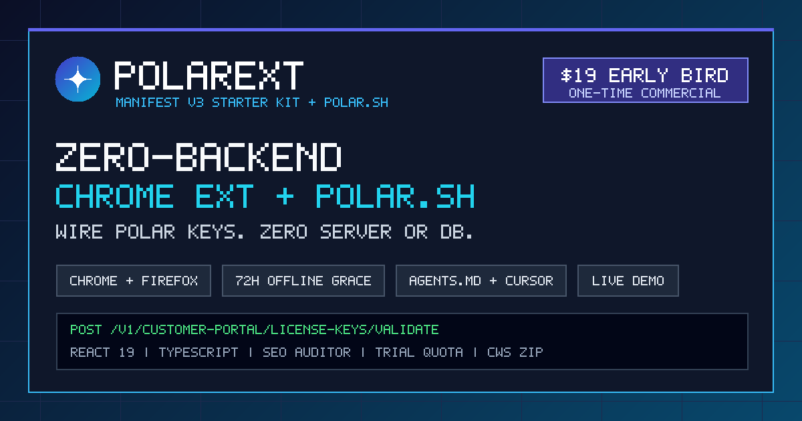

# PolarExt — Zero-Backend Chromium & Firefox MV3 + Polar.sh Starter Kit (v1.2)

**Lemon Squeezy is sunsetting. Wire Polar.sh license keys into your Manifest V3 Chromium (Chrome, Edge, Brave) & Firefox extension — zero backend, zero monthly server cost, 27 automated tests.**

- **Live Landing Page & Interactive In-Browser Simulator:** https://jas845323.github.io/polarext/
- **Privacy Policy (Chrome Web Store Ready):** https://jas845323.github.io/polarext/privacy.html
- **Early Bird Checkout ($19 USD one-time):** https://buy.polar.sh/polar_cl_JOUtaxug7idO6T32vNYuAYgL67hf6MvtT37IR3iRD2N
- **Standard License Checkout ($29 USD one-time):** https://buy.polar.sh/polar_cl_pi57oDERpuWUxarZU1yR8bZvIvdNUXwage0353rOJAJ

## What's Inside PolarExt v1.2?

- **Zero-Backend Polar.sh License Engine:** Direct calls to `/v1/customer-portal/license-keys/activate`, `/validate`, and `/deactivate` using only your public Organization ID, with seat limits, metered usage (`increment_usage`), and a **72-hour offline grace cache**.
- **Daily Free-Trial Quota Engine:** Local UTC-resetting freemium action limiter (`src/lib/trial-quota.ts`) with automatic Pro bypass.
- **AI Coding-Agent Rules Built In:** Ships with `AGENTS.md`, `CLAUDE.md`, and `.cursor/rules/polarext-mv3.mdc` so Cursor, Claude Code, and Copilot respect MV3 constraints, CSP safety, and Polar API contracts out of the box.
- **Cross-Browser MV3 (Chrome, Edge, Brave, Arc & Firefox):** `npm run build` for Chromium (`dist/`) and `npm run build:firefox` for Firefox (`dist-firefox/` with `sidebar_action` + `browser_specific_settings.gecko`).
- **Standalone SEO & Link Security Auditor:** Working MV3 extension (Popup, 4-tab Side Panel, `Alt+Shift+P` shortcut, Options page with System/Light/Dark override, 10-page local history, and CSV / JSON / Markdown export).
- **Turnkey Developer Pipeline:** `npm run setup` rebranding CLI, `npm run dev` watch mode, pure Node.js PNG generators (`16`/`32`/`48`/`128` icons + `1280x800` CWS screenshots + `440x280` promo tile + `1200x630` OG card), 25+ Vitest tests, and validated Chrome Web Store ZIP packager.

## Pricing

- **Early Bird (First 20 Buyers):** $19 USD one-time (instant GitHub Private Repo invite + full source ZIP)
- **Standard License:** $29 USD one-time
